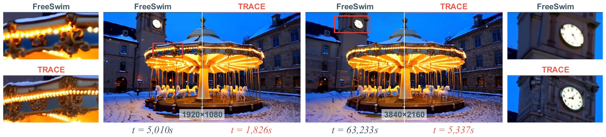

  

<h2 align="center">Trajectory Synchronization for Training-Free Resolution Extension in Video Generation</h2>

  <a href="https://www.libozhu.com/">Libo Zhu</a>1 &nbsp;·&nbsp; Fan Li2 &nbsp;·&nbsp; Zhixin Wang2 
  Binglu Wang3 &nbsp;·&nbsp; Weisheng Dong4 &nbsp;·&nbsp; <a href="https://yulunzhang.com/">Yulun Zhang</a>1,*

  1 Shanghai Jiao Tong University &nbsp;&nbsp; 2 Huawei Technologies Ltd. 
  3 Northwest Polytechnical University &nbsp;&nbsp; 4 Xidian University 
  * Corresponding author

  
  &nbsp;
  &nbsp;

  <a href="#overview">Overview</a> &nbsp; / &nbsp;
  <a href="#method">Method</a> &nbsp; / &nbsp;
  <a href="#results">Results</a> &nbsp; / &nbsp;
  <a href="#release-status">Release</a>

  
   <b>Figure 1.</b> High-resolution generation with rich detail and temporal consistency across video backbones.

## Overview

**TRACE** extends pretrained video generators to higher resolutions without training. It synchronizes low- and high-resolution denoising trajectories, refines local detail, and corrects duplicated subjects while preserving detail elsewhere.

<table>
  <tr>
    <td align="center" width="33%"><b>Training-free</b> Frozen pretrained backbones</td>
    <td align="center" width="34%"><b>1080p · 1440p · 4K</b> High-resolution video generation</td>
    <td align="center" width="33%"><b>2.0–2.9× faster</b> End-to-end speedup over FreeSwim</td>
  </tr>
</table>

<b>Read the full abstract</b>

More text-to-video models are available, but many remain limited to low resolutions. Training them for higher resolutions is costly, while existing training-free methods still struggle with fine detail, scene structure, and efficiency. We propose TRACE, a training-free method that synchronizes low- and high-resolution generation trajectories. During early denoising, TRACE aligns predicted scene content at corresponding noise levels. It computes high-resolution updates from low-resolution predictions and the current high-resolution state, without high-resolution model inference. The high-resolution trajectory retains fine-grained variation for generating new details. Local window attention then refines fine details in a shared high-resolution latent state. TRACE checks suspected duplicate subjects against the corresponding low-resolution layout and corrects selected regions and their solver history while preserving detail elsewhere. Experiments across all kinds of video generation backbones and resolutions show improved perceptual quality and text–video alignment over FreeSwim, a state-of-the-art training-free method, with 2.0–2.9× end-to-end speedups. Our code and models will be released at https://github.com/libozhu03/TRACE.

## Method

**Cross-scale trajectory synchronization (CSTS)** constructs early high-resolution updates from low-resolution predictions and the current high-resolution state, avoiding high-resolution model inference. Window attention then refines local detail on a shared latent state. **Trajectory-guided structural correction (TGSC)** uses low-resolution references to identify duplicated subjects and correct selected regions and their solver history.

  
   <b>Figure 3 from the paper.</b> CSTS guides early denoising, window attention refines detail, and TGSC corrects duplicated subjects.

## Results

TRACE improves perceptual quality and text–video alignment over FreeSwim across the three evaluated backbones. The benchmark uses **120 fixed prompt–reference pairs**, matched seeds, and **81 frames at 16 FPS**.

| Backbone | Resolution | Q-Align ↑ · FreeSwim → TRACE | Speedup |
| :--- | :---: | :---: | :---: |
| Wan2.1-T2V-1.3B | 1920 × 1088 | 4.381 → **4.690** | **2.74×** |
| Wan2.2-T2V-A14B | 2560 × 1440 | 4.524 → **4.752** | **2.92×** |
| Bernini-R-1.3B | 1920 × 1088 | 4.572 → **4.727** | **2.02×** |

Table 1 and Section 4.2 of the paper. End-to-end latency is measured on one A800 GPU and includes low-resolution sampling, VAE transfers, and structural correction.

<b>End-to-end inference times</b>

| Backbone | FreeSwim (s) | TRACE (s) |
| :--- | ---: | ---: |
| Wan2.1-T2V-1.3B | 5,010 | **1,826** |
| Wan2.2-T2V-A14B | 27,788 | **9,526** |
| Bernini-R-1.3B | 5,708 | **2,831** |

  
   <b>Figure 2 from the paper.</b> FreeSwim and TRACE at 1080p and 4K; central panels show full frames and outer columns show matched detail crops.

<a href="https://libozhu03.github.io/TRACE/"><b>Explore all comparisons and ablations on the project page →</b></a>

## Release status

| Project page | Paper on arXiv | Code and models |
| :---: | :---: | :---: |
| [Available](https://libozhu03.github.io/TRACE/) | Coming soon | Coming soon |

Code and models will be released in this repository. The arXiv link and citation will be added after submission.
