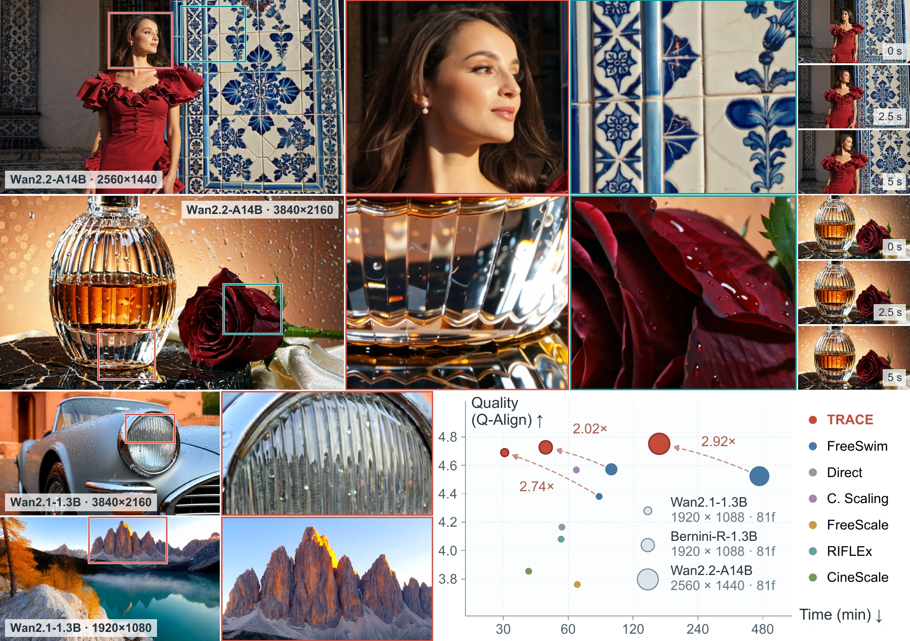
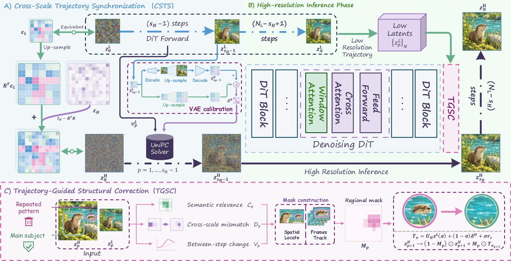
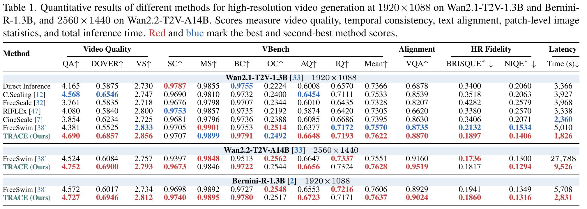
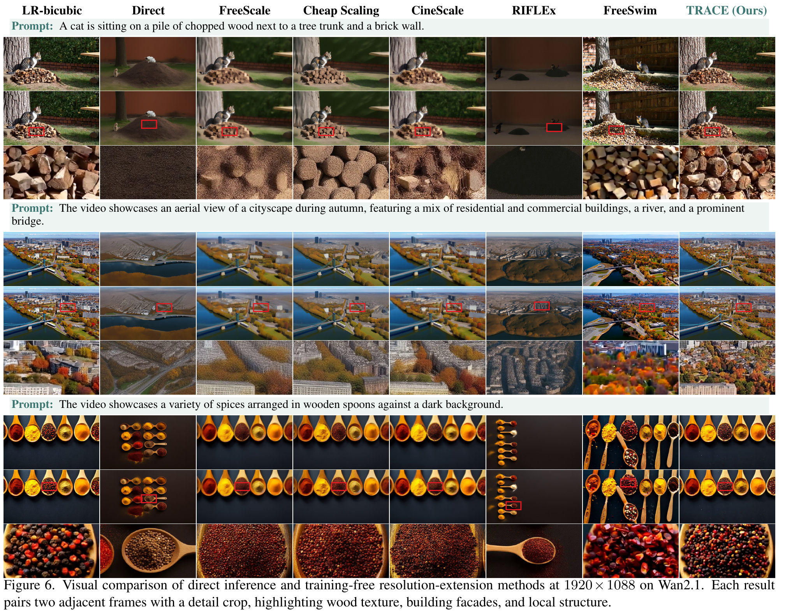

  

<h2 align="center">Trajectory Synchronization for Training-Free Resolution Extension in Video Generation</h2>

  <a href="https://www.libozhu.com/">Libo Zhu</a>1 &nbsp;·&nbsp; Fan Li2 &nbsp;·&nbsp; Zhixin Wang2 
  Binglu Wang3 &nbsp;·&nbsp; Weisheng Dong4 &nbsp;·&nbsp; <a href="https://yulunzhang.com/">Yulun Zhang</a>1,*

  1 Shanghai Jiao Tong University &nbsp;&nbsp; 2 Huawei Technologies Ltd. 
  3 Northwest Polytechnical University &nbsp;&nbsp; 4 Xidian University 
  * Corresponding author

  
  &nbsp;
  &nbsp;
  &nbsp;
  &nbsp;

## 📖 Overview

More text-to-video models are available, but many remain limited to low resolutions. Training them for higher resolutions is costly, while existing training-free methods still struggle with fine detail, scene structure, and efficiency. We propose TRACE, a training-free method that synchronizes low- and high-resolution generation trajectories. During early denoising, TRACE aligns predicted scene content at corresponding noise levels. It computes high-resolution updates from low-resolution predictions and the current high-resolution state, without high-resolution model inference. The high-resolution trajectory retains fine-grained variation for generating new details. Local window attention then refines fine details in a shared high-resolution latent state. TRACE checks suspected duplicate subjects against the corresponding low-resolution layout and corrects selected regions and their solver history while preserving detail elsewhere. Experiments across all kinds of video generation backbones and resolutions show improved perceptual quality and text–video alignment over FreeSwim, a state-of-the-art training-free method, with 2.0–2.9× end-to-end speedups.

  
   <b>Figure 1.</b> High-resolution generation with rich detail and temporal consistency across video backbones.

## 🧩 Method

**Cross-scale trajectory synchronization (CSTS)** constructs early high-resolution updates from low-resolution predictions and the current high-resolution state, avoiding high-resolution model inference. Window attention then refines local detail on a shared latent state. **Trajectory-guided structural correction (TGSC)** uses low-resolution references to identify duplicated subjects and correct selected regions and their solver history.

  
   <b>Figure 3 from the paper.</b> CSTS guides early denoising, window attention refines detail, and TGSC corrects duplicated subjects.

## 🔎 Results

TRACE delivers better perceptual quality and text alignment across all three backbones, with 2.0–2.9× end-to-end speedups over FreeSwim.

<b>Quantitative comparisons — Table 1 of the paper</b>

  

<b>Visual comparison — Figure 6 of the paper</b>

  

## Release status

- [x] Project page
- [x] [Paper and supplementary material](https://github.com/libozhu03/TRACE/releases/tag/paper)
- [ ] Paper on arXiv
- [ ] Code and models

## 📎 Citation

The citation will be added after arXiv submission.
